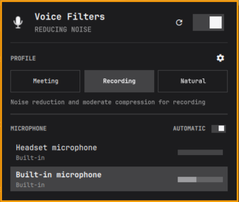
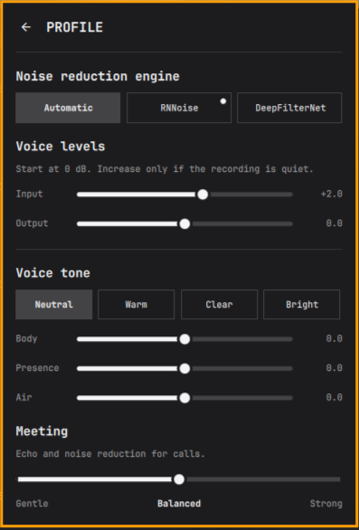

# Omarchy Voice Filters

A virtual PipeWire microphone with noise reduction, voice profiles, live gain controls, and an Omarchy bar panel. The output device is named `voicefilters`, so it can be selected in Superwhisper, meeting apps, recorders, or Omarchy's native Audio panel.





## Install

```bash
omarchy plugin add https://github.com/andrecards/omarchy-voice-filters.git --enable
omarchy restart shell
```

The plugin needs Omarchy Shell and PipeWire. RNNoise uses `noise-suppression-for-voice`; the optional compressor and limiter use `lsp-plugins`. DeepFilterNet is optional. The panel identifies a missing processing engine and its package. It never installs packages itself.

Install `noise-suppression-for-voice` and, for compression and limiting, `lsp-plugins` through Omarchy's package menu. DeepFilterNet requires the optional `libdeep_filter_ladspa-bin` package from the AUR.

## Use

Open the Voice Filters bar widget and select a profile:

- **Recording** reduces noise without echo cancellation. It is the initial profile and usually suits dictation.
- **Meeting** adds WebRTC echo cancellation for calls played through speakers.
- **Natural** applies a high-pass filter and preserves ambient sound and music.

The tuning page offers engine selection, Gentle/Balanced/Strong processing, input and output gain from -12 to +12 dB, and a voice tone equalizer. Start at 0 dB gain. Strong processing can clip quiet syllables. If the physical microphone clips, lower its hardware input level first.

The plugin does not change the system default microphone on a new installation. Enable the default-input switch in the panel if you want applications to select it automatically. Otherwise select `voicefilters` in each application. The plugin restores the previous physical default when this option is turned off or the plugin is disabled.

Optional CLI controls:

```bash
omarchy-shell io.github.andrecards.voicefilters status
omarchy-shell io.github.andrecards.voicefilters tune
omarchy-shell io.github.andrecards.voicefilters preset podcast
omarchy-shell io.github.andrecards.voicefilters gain capture 0
omarchy-shell io.github.andrecards.voicefilters gain output 0
omarchy-shell io.github.andrecards.voicefilters off
omarchy-shell io.github.andrecards.voicefilters on
```

To use it in Superwhisper: `superwhisper audio select voicefilters`.

## Language

English is the base language. The plugin follows the language selected in Omarchy Setup > Language without a shell restart. Its `i18n/` catalogs currently provide English and Brazilian Portuguese; other languages fall back to English. English source labels alone are not machine translated by the Shell.

## Update and remove

```bash
omarchy plugin update io.github.andrecards.voicefilters
omarchy restart shell
omarchy plugin remove io.github.andrecards.voicefilters --yes
```

A full Shell restart after an update prevents stale QML or JavaScript code from keeping an old audio graph in memory. Before removal, select a physical microphone as the system default if the virtual one is active.

## Attribution and license

Based on [Omavoice](https://github.com/gigasolo/omavoice) by GigaSolo LLC. See [NOTICE](NOTICE) and [LICENSE](LICENSE) for the original MIT license and attribution.
